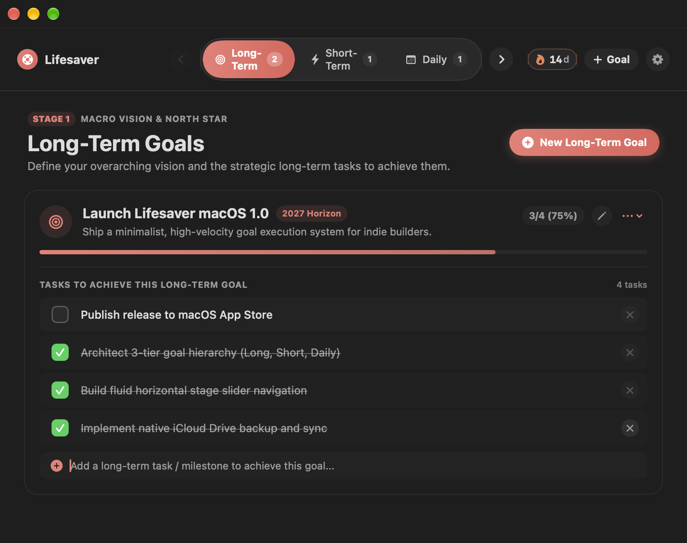

<p align="center">
  
</p>

# Lifesaver

A minimalist, high-velocity goal and daily execution system for macOS built with **SwiftUI** and **SwiftData**.

Designed with the restraint of native Apple interfaces (Things 3, Linear, Apple Reminders) — free from AI clichés, emoji overload, and unnecessary complexity.

---

## Architecture & Core Features

### 1. 3-Tier Goal Hierarchy
- **Long-Term Goals**: Set your 1-to-5 year horizons and define macro milestones.
- **Short-Term Goals**: Tactical sprint and monthly targets linked to actionable short-term and daily tasks.
- **Daily Goals & Actions**: What you need to achieve today, with rapid inline task entry and direct completion tracking.

### 2. Gesture-Driven Stage Progression
- **Top Center Sliding Capsule**: Quick ⌘← and ⌘→ navigation between stages with live item counters.
- **Left-to-Right Stage Flow**: Fluid horizontal track providing macro-to-micro clarity without fragmented tabs or multi-page navigation.

### 3. Streak & Activity Engine
- **Streak Tracker**: Tracks consecutive days of activity derived from task and goal completions.
- **7-Day Rolling Activity Strip**: Clean visual overview of daily progress.
- **Lifesaver Freezes**: 2 replenished monthly rest day freezes to protect streaks.

### 4. iCloud Drive Sync & Backup
- **Automatic Backup & Sync**: Snapshot persistence to iCloud Drive.
- **Manual Export & Restore**: One-click JSON backup export and restore directly from Settings (`⌘,`).

---

## Tech Stack

- **Platform**: macOS 15.0+
- **Language**: Swift 6
- **UI Framework**: SwiftUI
- **Persistence**: SwiftData (`@Model`, `ModelContext`)
- **Architecture**: Single-container reactive observable store (`@Observable`)

---

## Development & Building

Open the project in Xcode:
```bash
open Lifesaver.xcodeproj
```

Or build from the command line:
```bash
xcodebuild -project Lifesaver.xcodeproj -scheme Lifesaver -destination 'platform=macOS' build
```

